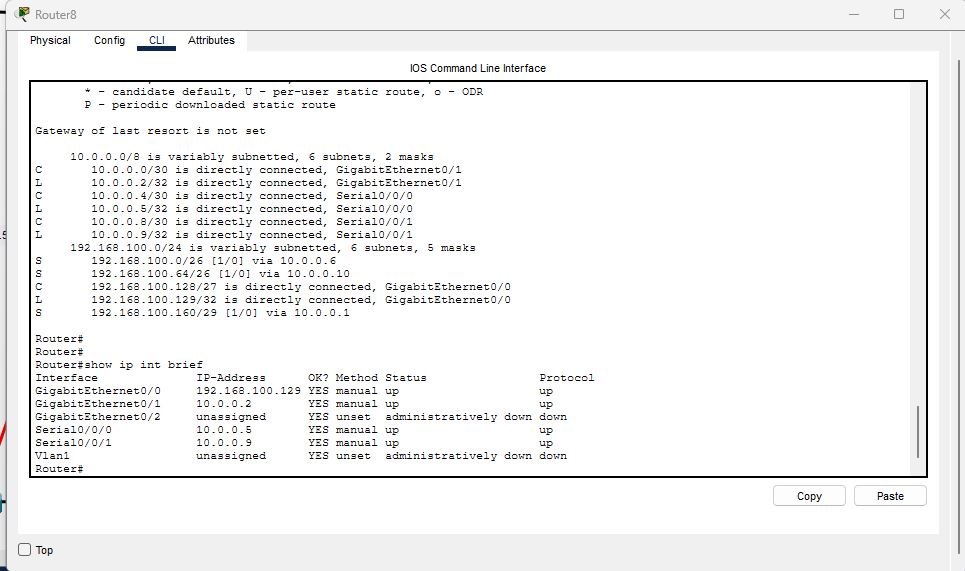

# Multi-Department Network Design with VLSM

### Cisco Packet Tracer | Networking Portfolio Project

## Project Overview

This project demonstrates the design and configuration of a multi-department network using Cisco Packet Tracer.

The network connects four departments—Human Resources (HR), Information Technology (IT), Accounting (AC), and Web—using separate IPv4 subnets and multiple Cisco routers.

The project focuses on VLSM subnetting, network addressing, router connectivity, and troubleshooting.

## Project Objectives

- Design a multi-department network topology.
- Apply Variable Length Subnet Masking (VLSM).
- Configure IPv4 addresses and subnet masks.
- Establish communication between multiple networks.
- Verify connectivity using ICMP Ping.
- Practice network troubleshooting.

## Network Topology

The topology includes four departmental LANs interconnected through Cisco routers.

## VLSM Subnetting Plan

| Department | Network Address | Subnet Mask | Usable Host Range |
|---|---|---|---|
| HR | 192.168.100.0/26 | 255.255.255.192 | 192.168.100.1–62 |
| Web | 192.168.100.64/26 | 255.255.255.192 | 192.168.100.65–126 |
| IT | 192.168.100.128/27 | 255.255.255.224 | 192.168.100.129–158 |
| Accounting | 192.168.100.160/29 | 255.255.255.248 | 192.168.100.161–166 |

## Network Components

- 4 Cisco Routers
- 4 Cisco 2960 Switches
- 4 PCs
- Ethernet and inter-router connections
- Cisco Packet Tracer

## Connectivity Testing

ICMP Ping tests were performed to check communication between devices on different networks.

The following destination IP addresses were successfully reached in recorded tests:

| Destination IP | Result |
|---|---|
| 192.168.100.2 | Successful |
| 192.168.100.66 | Successful |
| 192.168.100.130 | Successful |
| 192.168.100.162 | Successful |

An additional test to 192.168.100.30 did not receive a response. The assignment and status of that address were not verified.

## Technical Skills Demonstrated

- IPv4 Addressing
- VLSM and Subnetting
- Network Topology Design
- Cisco Router and Switch Configuration
- Multi-Router Connectivity
- ICMP Testing
- Network Troubleshooting

## Key Learning Outcomes

Through this project, I practiced dividing an IPv4 address space into different subnets, designing a departmental network, connecting multiple routers, and verifying network communication.

## Tools Used

- Cisco Packet Tracer
- Cisco IOS CLI
- ICMP Ping
- GitHub for Project Documentation

## Author

**Kavindu Supun Jayanath**

Higher Diploma in Network Technology & Cybersecurity

ICBT Campus, Sri Lanka
